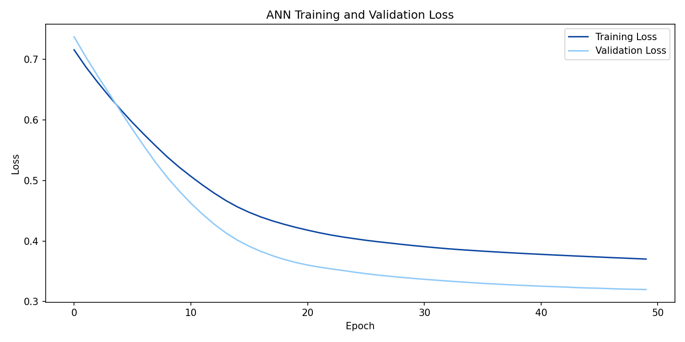
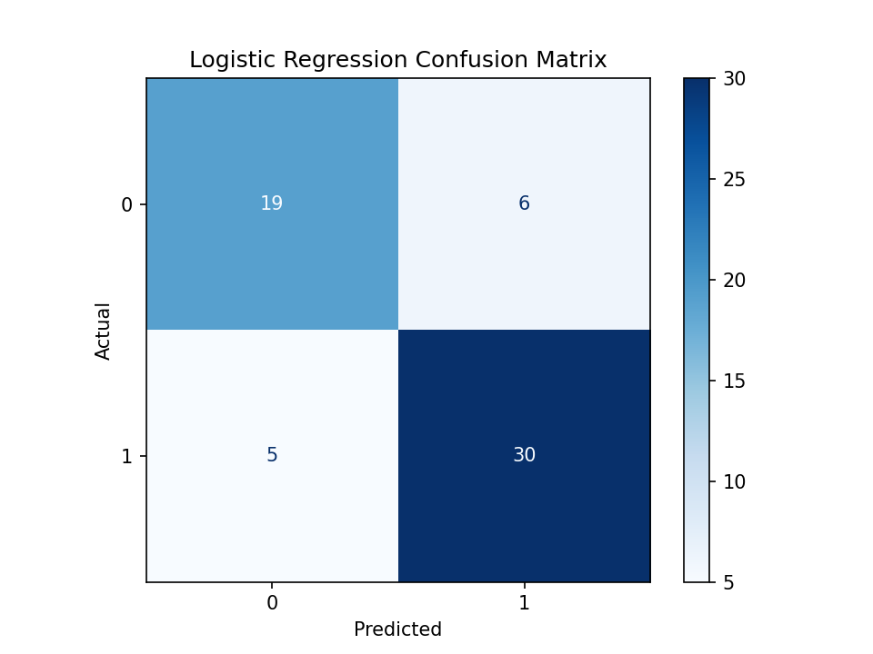
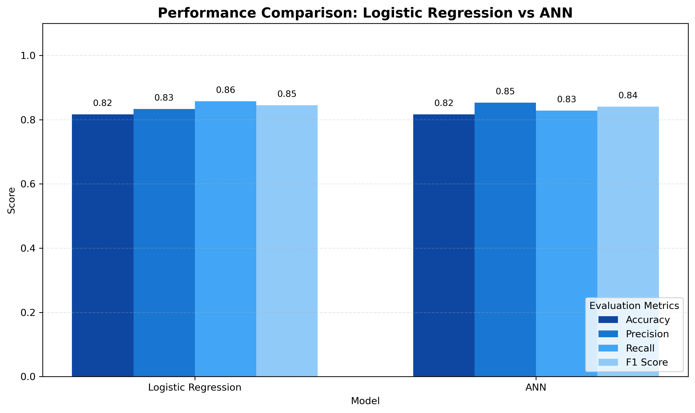
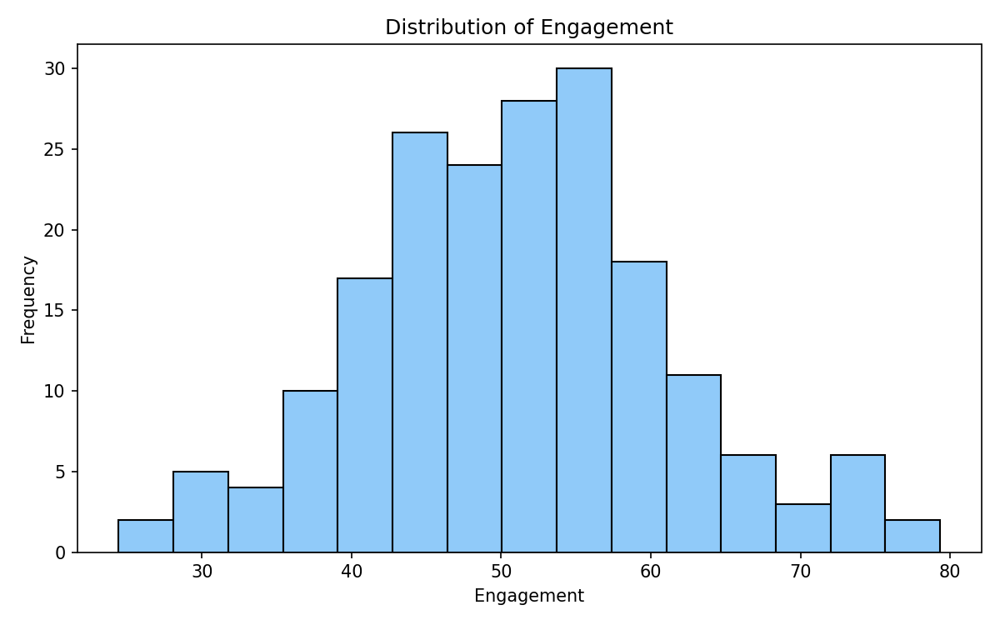

# 🚚📊 Late Delivery Prediction & Operational Segmentation — Set A2

> **Data Science & AI/ML Practical Project** | Python · Machine Learning · Clustering · Artificial Neural Network

This repository contains an end-to-end practical workflow for exploring a dataset, preparing features, building classification models, segmenting records with K-Means, and comparing model performance. The notebook, input data, saved model artifacts, prediction files, evaluation tables, and output figures are included in this folder.

---

## 📌 Table of Contents

- [🎯 Project Overview](#-project-overview)
- [💡 Problem Statement](#-problem-statement)
- [🧭 Project Objectives](#-project-objectives)
- [🧰 Technology Stack](#-technology-stack)
- [📂 Repository Structure](#-repository-structure)
- [🗃️ Dataset Overview](#️-dataset-overview)
- [🔄 Workflow and Tasks](#-workflow-and-tasks)
- [🤖 Models Used](#-models-used)
- [📈 Results and Evaluation](#-results-and-evaluation)
- [🖼️ Output Gallery](#️-output-gallery)
- [📁 Output Files Explained](#-output-files-explained)
- [⚙️ Installation and Setup](#️-installation-and-setup)
- [▶️ How to Run](#️-how-to-run)
- [🧠 Interpretation and Limitations](#-interpretation-and-limitations)
- [🔁 Reproducibility](#-reproducibility)
- [👨‍💻 Author](#-author)

---

## 🎯 Project Overview

The project combines **supervised learning** and **unsupervised learning** in one notebook. The classification workflow predicts a binary target (class `0` or class `1`) and compares Logistic Regression with a simple majority-class baseline. A separate Artificial Neural Network (ANN) workflow generates probability-based predictions. K-Means clustering is used to explore whether records can be grouped into two or more operational segments based on numeric behavior features.

The notebook also includes data inspection, preprocessing, model evaluation, visualizations, and exporting results so that the work can be reviewed without rerunning every cell.

## 💡 Problem Statement

Use a structured dataset to demonstrate a complete machine-learning workflow: inspect and prepare the data, build predictive models for a binary outcome, compare classification performance using appropriate metrics, and explore underlying groups through clustering. The project is intended as a learning/practical exercise; model results should not be treated as production-ready business predictions without further validation.

## 🧭 Project Objectives

- 🧹 Inspect the raw dataset and investigate missing values, duplicate records, and target distribution.
- 🛠️ Prepare model-ready features using suitable preprocessing steps.
- 🧪 Separate predictors from the target and reduce the risk of target leakage.
- 📊 Establish a majority-class baseline before evaluating a trained classifier.
- 🤖 Train and evaluate a Logistic Regression classification model.
- 🧩 Use K-Means to explore possible record segments and compare candidate cluster counts.
- 🧠 Train an ANN and monitor training/validation loss.
- 📏 Compare models using accuracy, precision, recall, and F1 score.
- 📉 Create visual outputs such as a confusion matrix, loss curve, and model comparison chart.
- 💾 Export predictions, evaluation tables, cluster assignments, plots, and trained artifacts.

## 🧰 Technology Stack

| Tool / Library | Purpose |
|---|---|
| 🐍 Python | Main programming language |
| pandas | Data loading, tabular manipulation, and CSV exports |
| NumPy | Numerical operations |
| Matplotlib | Plotting and output figures |
| scikit-learn | Preprocessing, baseline/classification models, metrics, and K-Means |
| TensorFlow / Keras | Building, training, and saving the ANN |
| Jupyter Notebook | Interactive project workflow and documentation |

## 📂 Repository Structure

```text
Set_A2/
├── setA2.ipynb                         # Main notebook: tasks, code, analysis
├── data/
│   └── raw/
│       └── set_d.csv                   # Input dataset
├── models/
│   ├── ann_model.keras                 # Saved trained ANN
│   └── preprocessing.pkl               # Saved preprocessing artifact(s)
└── outputs/
    ├── ann_test_predictions.csv        # ANN predictions and probabilities
    ├── cluster_assignments.csv         # Cluster assignment for each record
    ├── cluster_profiles.csv            # Numeric summary by cluster
    ├── kmeans_selection.csv            # K-Means selection metrics
    ├── logistic_test_predictions.csv    # Logistic Regression test predictions
    ├── supervised_metrics.csv           # Baseline and Logistic Regression metrics
    └── figures/
        ├── ann_loss_curve.png           # Training/validation loss curve
        ├── confusion_matrix.png         # Classification confusion matrix
        ├── data_distibution.png         # Data distribution plot (filename as supplied)
        ├── final_model_comparison.png   # Model metric comparison chart
        └── hist_plot.png                # Histogram visualization
```

## 🗃️ Dataset Overview

- **Input file:** `data/raw/set_d.csv`
- **Format:** CSV (comma-separated values)
- **Usage:** Data exploration, feature preparation, classification, and clustering
- **Target:** Binary labels represented as `0` and `1` in the supervised prediction outputs
- **Segmentation features in the exported cluster profile:** `visits`, `recency`, `engagement`, and `spend`

The exact column definitions and preprocessing decisions should be confirmed in `setA2.ipynb`, which is the authoritative record of the implemented workflow. Please consult the notebook before interpreting any feature as a real-world business definition.

## 🔄 Workflow and Tasks

### 1️⃣ Data inspection and statistical exploration

- Load the CSV data into a DataFrame.
- Review the dataset's dimensions, columns, data types, and summary statistics.
- Check data quality, including missing values, duplicate rows, and target-class balance.
- Use plots to understand distributions and identify patterns that may require preprocessing.

### 2️⃣ Data preprocessing and feature engineering 🧹

- Prepare numeric and categorical columns for model input.
- Handle missing numeric values using an imputation strategy.
- Encode categorical features where required.
- Scale numeric features when appropriate for the selected algorithm.
- Keep the target separate from predictor features and avoid using identifier/target information as input features.
- Fit preprocessing transformations on training data where applicable, then apply the fitted transformations to other splits.

### 3️⃣ Supervised classification — Logistic Regression 🤖

- Build a majority-class baseline to provide a simple point of comparison.
- Train Logistic Regression for the binary target.
- Generate predictions for the held-out test data.
- Evaluate predictions with accuracy, precision, recall, and F1 score.
- Review the confusion matrix to understand correct and incorrect predictions.
- Save test predictions and evaluation metrics to CSV files.

### 4️⃣ Unsupervised learning — K-Means clustering 🧩

- Evaluate candidate cluster counts `k = 2`, `k = 3`, and `k = 4`.
- Compare **inertia** (within-cluster sum of squared distances) and **silhouette score** (a measure of how well-separated clusters are).
- Select a candidate using the computed silhouette scores.
- Export record-level cluster assignments and cluster-level feature summaries.

### 5️⃣ Deep learning — Artificial Neural Network (ANN) 🧠

- Build a feed-forward neural network for binary classification.
- Train the network while tracking validation loss.
- Use the trained network to produce class predictions and class-1 probabilities.
- Visualize training and validation loss to inspect learning behavior.
- Save the trained Keras model and test predictions.
- Compare ANN performance with the other reported classification results using the notebook's evaluation workflow.

### 6️⃣ Reporting and exports 📦

The final outputs include a metrics table, prediction files, clustering summaries, saved model artifacts, and plots. These files support review of the results and make it easier to present the practical work or push it to GitHub.

## 🤖 Models Used

### Majority-class baseline

A simple reference model that predicts the most frequent class. It helps determine whether a trained model offers improvement over a naive strategy. It is not expected to learn meaningful relationships from the features.

### Logistic Regression

A commonly used classification algorithm that estimates the probability of a binary outcome. It provides an interpretable baseline for comparison with a neural network.

### K-Means

An unsupervised clustering algorithm that groups records based on similarity in the feature space. Cluster IDs (`0`, `1`, etc.) are arbitrary identifiers and do **not** represent target classes or an ordered ranking.

### Artificial Neural Network (ANN)

A feed-forward neural network used to learn nonlinear relationships between input features and the binary outcome. The included artifacts contain a saved Keras model, prediction probabilities, and a training/validation loss plot.

## 📈 Results and Evaluation

### Supervised model metrics

The following values are read from `outputs/supervised_metrics.csv` and are reported as fractions from `0` to `1`.

| Model | Accuracy | Precision | Recall | F1 Score |
|---|---:|---:|---:|---:|
| Majority-class baseline | 0.5833 (58.33%) | 0.5833 (58.33%) | 1.0000 (100.00%) | 0.7368 (73.68%) |
| Logistic Regression | **0.8167 (81.67%)** | **0.8333 (83.33%)** | 0.8571 (85.71%) | **0.8451 (84.51%)** |

**Interpretation:** On the included test split, Logistic Regression improves accuracy from **58.33% to 81.67%** and F1 score from **73.68% to 84.51%** compared with the majority-class baseline. The baseline's 100% recall should not be read as strong overall performance: it predicts the majority class and has low precision/accuracy on the minority class. Precision and recall should be interpreted alongside the cost of false positives and false negatives.

> ℹ️ The `supervised_metrics.csv` file contains the baseline and Logistic Regression rows. ANN predictions are provided separately in `ann_test_predictions.csv`; the ANN metrics can be recomputed from its `true_label` and `predicted_label` columns. On the included ANN predictions, accuracy is approximately **81.67%**, precision **85.29%**, recall **82.86%**, and F1 **84.06%**.

### K-Means candidate selection

Values below come from `outputs/kmeans_selection.csv`.

| Number of clusters (`k`) | Inertia | Silhouette score |
|---:|---:|---:|
| 2 | 713.0304 | **0.2259** |
| 3 | 613.5511 | 0.1872 |
| 4 | 541.6453 | 0.1907 |

**Interpretation:** `k = 2` has the highest silhouette score among the three tested candidates. Inertia decreases as `k` increases, which is expected because more clusters can fit the data more closely. The silhouette scores are relatively modest, so the resulting groups should be treated as exploratory segments rather than strongly separated natural clusters.

### Cluster profiles

The supplied `cluster_profiles.csv` summarizes four numeric features for each cluster.

| Cluster | Visits (average) | Recency (average) | Engagement (average) | Spend (average) |
|---:|---:|---:|---:|---:|
| 0 | 49.36 | 55.42 | 46.09 | 50.18 |
| 1 | 49.54 | 43.93 | 57.45 | 50.97 |

**Initial observation:** Cluster 1 has higher average engagement and spend, and lower average recency, than Cluster 0 in the exported profile. Validate the units, definitions, and direction of these features in the notebook before giving these groups a business label.

## 🖼️ Output Gallery

The figures below are embedded from `outputs/figures/`. They should render on GitHub when the README is viewed from the project root.

### 📉 ANN training and validation loss

This curve helps inspect whether training and validation loss improve together and whether the model may be overfitting.



### 🎯 Confusion matrix

A confusion matrix shows correct and incorrect classifications by actual and predicted class. Use it alongside precision and recall to understand error types.



### 📊 Final model comparison

The comparison figure summarizes the model metrics produced by the notebook.



### 📈 Data distribution

Use this visualization to review the distribution of values in the data.




## 📁 Output Files Explained

| File | What it contains / why it is useful |
|---|---|
| `outputs/supervised_metrics.csv` | Accuracy, precision, recall, and F1 for the baseline and Logistic Regression |
| `outputs/logistic_test_predictions.csv` | Actual and predicted labels for the Logistic Regression test set |
| `outputs/ann_test_predictions.csv` | Record ID, true label, predicted label, and class-1 probability for the ANN test set |
| `outputs/kmeans_selection.csv` | Candidate `k` values, inertia, and silhouette scores |
| `outputs/cluster_assignments.csv` | Record-level K-Means cluster labels |
| `outputs/cluster_profiles.csv` | Average feature values grouped by cluster |
| `outputs/figures/ann_loss_curve.png` | ANN training and validation loss visualization |
| `outputs/figures/confusion_matrix.png` | Confusion matrix plot |
| `outputs/figures/final_model_comparison.png` | Visual comparison of model metrics |
| `outputs/figures/data_distibution.png` | Data distribution figure (filename retained as provided) |
| `outputs/figures/hist_plot.png` | Histogram figure |
| `models/ann_model.keras` | Saved ANN model for later loading/inference |
| `models/preprocessing.pkl` | Serialized preprocessing object(s) used in the workflow |

## ⚙️ Installation and Setup

### Prerequisites

- Python 3.10 or a compatible version supported by your installed TensorFlow release
- `pip`
- Jupyter Notebook or JupyterLab

### Install dependencies

Open a terminal and run:

```bash
pip install pandas numpy matplotlib scikit-learn tensorflow jupyter
```

If the notebook imports any additional package, install that package as well. For reproducible results, use a virtual environment and record the versions used for the practical.

### Optional: create a virtual environment

**Windows (PowerShell):**

```powershell
python -m venv .venv
.venv\Scripts\Activate.ps1
python -m pip install --upgrade pip
pip install pandas numpy matplotlib scikit-learn tensorflow jupyter
```

**macOS / Linux:**

```bash
python3 -m venv .venv
source .venv/bin/activate
python -m pip install --upgrade pip
pip install pandas numpy matplotlib scikit-learn tensorflow jupyter
```

## ▶️ How to Run

1. 📥 Download or clone this repository and extract the ZIP if needed.
2. 📂 Open a terminal and change into the `Set_A2` project directory (the directory containing `setA2.ipynb`).
3. 🚀 Start Jupyter:

   ```bash
   jupyter notebook
   ```

4. 📓 Open `setA2.ipynb` in the browser.
5. ▶️ Run the notebook cells in order, from the first cell to the last.
6. 📊 Inspect the printed evaluation metrics and charts.
7. 💾 Check `outputs/` for generated CSVs and plots, and `models/` for saved model artifacts.

**Important:** Run the notebook with the project root as the working directory. The code uses relative paths such as `data/raw/set_d.csv`, `outputs/`, and `models/`. Rerunning cells may overwrite existing output files.

## 🧠 Interpretation and Limitations

- 📌 **Test-set metrics are estimates:** results apply to the supplied split and may vary on new data.
- ⚖️ **Accuracy is not enough:** precision, recall, F1, and the confusion matrix provide additional context, particularly when classes are imbalanced.
- 🚦 **Error costs matter:** the preferred model depends on the real cost of false positives versus false negatives.
- 🧩 **Clusters are exploratory:** cluster IDs are arbitrary, and a higher cluster count is not automatically better.
- 🔍 **Feature meaning matters:** confirm the units and definitions of features before interpreting cluster profiles.
- 🔒 **Preprocessing must match training:** when loading the saved ANN for inference, apply the same preprocessing steps and feature order used during training.
- 🧪 **Further validation is recommended:** consider cross-validation, threshold analysis, calibration, and evaluation on a separate unseen dataset before any real-world use.
- 📚 **Educational project:** the supplied results demonstrate a practical workflow and should not be considered a guarantee of operational performance.

## 🔁 Reproducibility

The notebook is the source of truth for the exact data split, feature engineering, model architecture, and training procedure. To reproduce the reported results, use the supplied input CSV, run notebook cells in order, and keep the preprocessing and feature order consistent. Small numerical differences may occur across Python/library versions, CPU/GPU environments, or random seeds.

## 👨‍💻 Author

**Yash Patel**  
B.Tech — Computer Engineering  
Focus areas: Data Analytics · Machine Learning · Deep Learning · Data Visualization

---

⭐ If you find this project useful for learning, feel free to star the repository on GitHub.

**Made with 🐍 Python, 📊 data, and 🤖 machine learning.**
